<picture>
  <source media="(prefers-color-scheme: dark)" srcset="assets/hero-dark.svg">
  
</picture>

I'm Surya. I founded [Sendiee](https://sendiee.com), where businesses run AI conversations with their customers on WhatsApp, Instagram and Messenger, and I'm a partner at [CodeStormX](https://www.codestormx.com). I also make [Strays](https://github.com/suryavmds/strays), a Mac menu bar app that finds whatever is still running in the background.

The picture above is this profile, drawn the way Strays draws a Mac. The numbers in it are real, and it redraws itself every week.

## Strays

<a href="https://github.com/suryavmds/strays"></a>

You start a dev server, forget it, and three days later something is still holding port 3000. Or an AI coding agent starts a watcher, the session ends, and the watcher keeps going with nobody watching it.

Strays lists all of it: listening ports, dev servers, Docker containers, Homebrew services. It tells you which agent left each one behind, and stops it in one click. Native Swift, 11 MB, free and open source.

```bash
brew install --cask suryavmds/tap/strays
```

## Sendiee

AI chatbots that answer customers, bulk campaigns, and lead segmentation across WhatsApp, Instagram and Messenger. Sendiee is an official Meta Business Partner. I founded it and still write a lot of the code.

[sendiee.com](https://sendiee.com)

<picture>
  <source media="(prefers-color-scheme: dark)" srcset="assets/timeline-dark.svg">
  
</picture>

<picture>
  <source media="(prefers-color-scheme: dark)" srcset="assets/stacks-dark.svg">
  
</picture>

<p align="center">
  <a href="mailto:surya@sendiee.com"><picture><source media="(prefers-color-scheme: dark)" srcset="assets/btn-email-dark.svg"></picture></a>
  <a href="https://www.linkedin.com/in/suryavmds"><picture><source media="(prefers-color-scheme: dark)" srcset="assets/btn-linkedin-dark.svg"></picture></a>
  <a href="https://sendiee.com"><picture><source media="(prefers-color-scheme: dark)" srcset="assets/btn-sendiee-dark.svg"></picture></a>
  <a href="https://dribbble.com/suryavmds"><picture><source media="(prefers-color-scheme: dark)" srcset="assets/btn-dribbble-dark.svg"></picture></a>
  <a href="https://instagram.com/suryavmds"><picture><source media="(prefers-color-scheme: dark)" srcset="assets/btn-instagram-dark.svg"></picture></a>
</p>

<p align="center"><sub>No third-party widgets here. <a href="scripts/build.py">A script in this repo</a> draws every picture from the GitHub API, and an Action reruns it each Monday.</sub></p>
